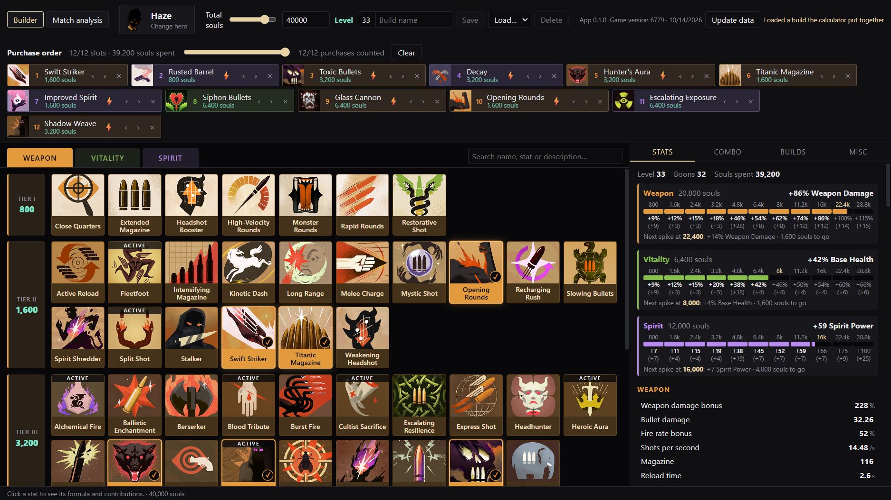
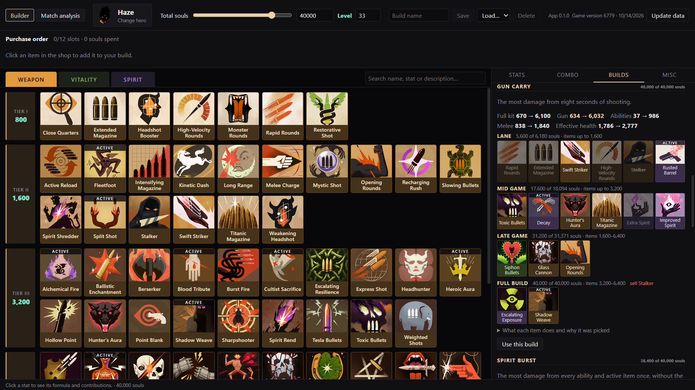
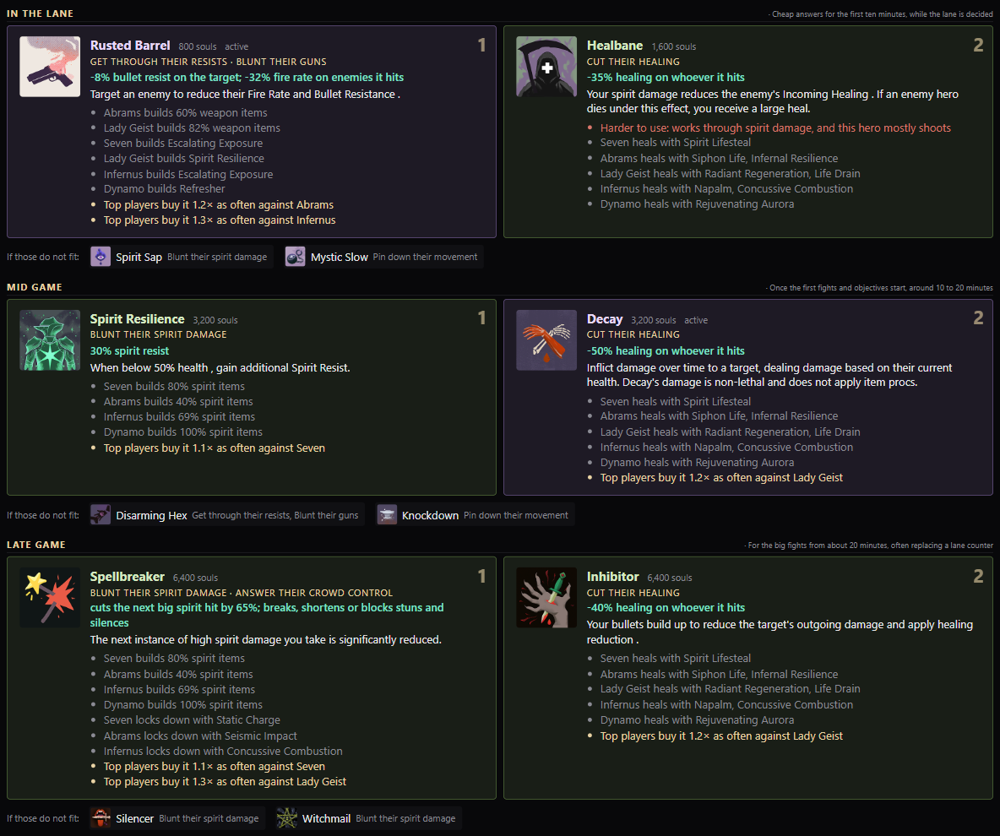
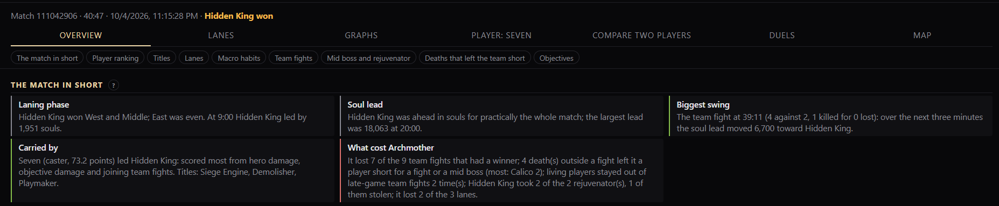
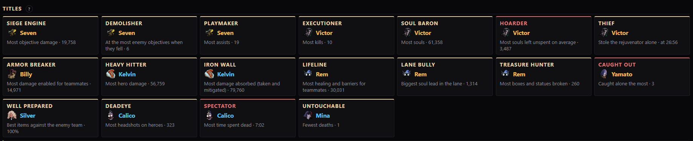
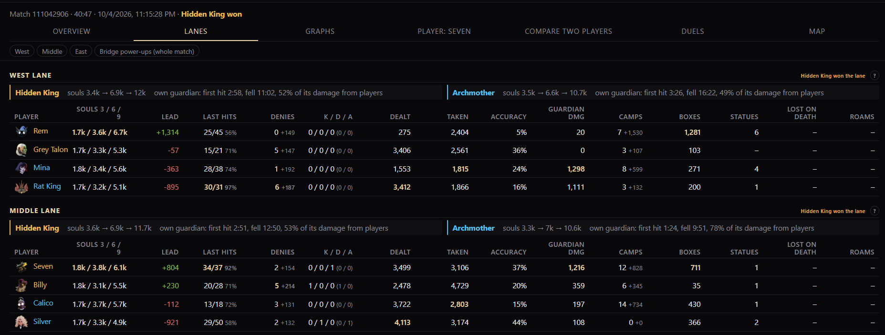
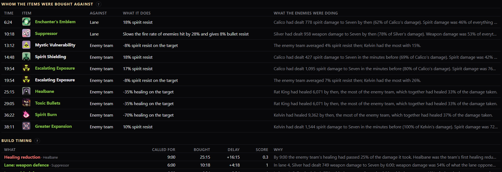

<p align="center">
  
</p>

<h1 align="center">Deadlock BCMA</h1>

<p align="center">
  <b>Build Calculator and Match Analysis for Deadlock</b><br>
  Every number worked out from the game's own data, and your matches broken down into what actually decided them.
</p>

<p align="center">
  <a href="https://github.com/Empera0/Deadlock-BCMA/releases/latest"><b>Download for Windows</b></a>
</p>

---

## Install

1. Download `Deadlock.BCMA_x.y.z_x64-setup.exe` from the [latest release](https://github.com/Empera0/Deadlock-BCMA/releases/latest).
2. Run it. Windows may say it protected your PC, because the installer is not signed with a paid certificate: click **More info → Run anyway**.
3. Leave the desktop shortcut ticked and finish; the app opens on its own.

The app updates itself: when a new version is out, an **Update** button appears in the top right.

## Build calculator



- A shop laid out like the game's, with every item's stats and text.
- Stats for any hero at any souls and level: weapon, vitality, spirit, and what they do against a target's health and resists. Click a stat to see how it is worked out.
- **Combo**: put abilities, shots, melee and items in order and see the damage, the time to kill and the healing.
- **Misc**: match mechanics worth knowing, such as the Unstable Rift's comeback resist for the team that is behind.

## Build generator

Open it from the sidebar on the left.



- **Calculated**: pick a playstyle (full kit, gun, spirit, melee or frontline) and the app builds it from scratch, the way a match goes: cheap items in the lane, bigger ones in the mid and late game, selling the cheapest once the slots are full. Every pick is the item that helps that playstyle the most per soul, using the hero's own abilities.
- **Popular**: the core build top players use on a hero, read from the last two weeks of Eternus lobbies, with the situational items they add.
- **Counters**: click up to six enemy heroes and right-click your own. The app picks two counter items each for the lane, the mid game and the late game. They answer what that team does and land easily for your hero, and a team of healers always gets its healing cut.



## Match analysis

Enter a match ID, your Steam account for your recent matches, or let the app find the matches you watched in game.



- **The match in short**: the lanes, the soul lead, the biggest swing, who carried and what cost the losing team.
- **Player ranking** from 0 to 100, scored by role, with the reasons behind every place.
- **Team fights**: who was there, who was not and what they were doing instead, and what the winner made of the fight.
- **Mid boss, objectives and deaths**: who took what, and which deaths left the team a player short.



**Titles** for whoever led the match in something, good or bad.



**Lanes**: souls at 3, 6 and 9 minutes, last hits, denies, trades with the lane opponents, guardian damage, camps and boxes, side by side.



**Builds in the match**: which enemy each item answered, whether resists, healing reduction and the like came in time, and what would have helped.

Analyze your last 10 matches together to see the habits that keep coming back.

## Data

Hero, item and match data come from the community [Deadlock API](https://deadlock-api.com). The app is not affiliated with Valve.

## For developers

Rust engine (`engine/`), Tauri 2 shell (`src-tauri/`), React + TypeScript UI (`src/`).

```bash
npm install
npm run tauri dev
```

Pushing a `v*` tag builds, signs and publishes a release through GitHub Actions. See the [changelog](CHANGELOG.md) for what changed in each version.
